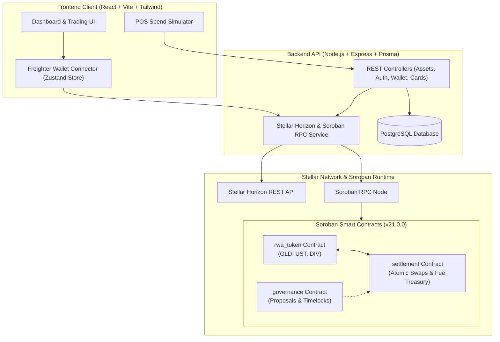

# Liquid Ledger — Tokenized Asset Liquidity Platform

[](https://github.com/ChelseaWin-Labs/Liquid-Ledger-Tokenized-Asset-Liquidity/actions)
[](https://soroban.stellar.org/)
[](LICENSE)
[](https://www.rust-lang.org/)
[](https://www.typescriptlang.org/)
[](https://vitejs.dev/)

**Liquid Ledger** is an institutional-grade decentralized finance (DeFi) platform built on **Stellar Soroban**. It unlocks real-time liquidity for tokenized Real-World Assets (RWAs)—such as gold bullion, US Treasury Bills, and diversified index funds—enabling users to hold yield-generating investments and spend them instantly at point-of-sale via non-custodial debit settlement.

---

## Table of Contents

1. [The Problem & Core Innovation](#the-problem--core-innovation)
2. [High-Level Architecture](#high-level-architecture)
3. [Smart Contract Workspace (Soroban v21)](#smart-contract-workspace-soroban-v21)
4. [Backend API & Liquidity Engine](#backend-api--liquidity-engine)
5. [Frontend Dashboard & Web3 Wallet](#frontend-dashboard--web3-wallet)
6. [Quickstart & Local Environment](#quickstart--local-environment)
7. [Automated Test Matrix](#automated-test-matrix)
8. [Deployment & Stellar Testnet](#deployment--stellar-testnet)
9. [Open Source Contributing Workflow](#open-source-contributing-workflow)
10. [Security & Responsible Disclosure](#security--responsible-disclosure)

---

## The Problem & Core Innovation

Traditional financial assets are locked into fragmented 9-to-5 banking hours and multi-day settlement windows ($T+1$ or $T+2$). When an investor needs instant cash, they are forced to sell assets, pay withdrawal penalties, and wait days for wire transfers.

Liquid Ledger bridges this gap using Stellar Soroban smart contracts:
- **Instant Spot Liquidation:** Assets are tokenized as fractional, yield-bearing RWA tokens.
- **Card-Ready Settlement:** When a user swipes their virtual debit card at a merchant terminal, the protocol calculates exact spot valuation, burns or transfers the equivalent asset fraction on Stellar, and settles the payment instantly in USD.
- **Atomic Multi-Asset Swaps:** Swap between Gold (`GLD`), Treasuries (`UST`), and diversified baskets (`DIV`) with replay protection and protocol fee routing.

---

## High-Level Architecture



---

## Smart Contract Workspace (Soroban v21)

Located in `smart-contracts/`, the contracts are organized into an isolated multi-contract Cargo workspace running on **Soroban SDK 21.0.0**:

| Contract | Path | Description | Key Functions |
| :--- | :--- | :--- | :--- |
| **`rwa_token`** | `contracts/rwa_token/` | Institutional tokenized RWA asset with yield metadata and compliance pauses. | `initialize`, `mint`, `burn`, `transfer`, `balance`, `allowance`, `get_asset_class`, `get_annual_yield_bps` |
| **`settlement`** | `contracts/settlement/` | Replay-protected atomic swap engine with protocol treasury fee splits. | `initialize`, `atomic_swap`, `set_fee_bps`, `set_treasury`, `set_supported_token`, `is_token_supported` |
| **`governance`** | `contracts/governance/` | Decentralized governance module with voting windows and timelocks. | `initialize`, `create_proposal`, `vote`, `queue_execution`, `execute_proposal`, `get_proposal` |

### Building Contracts
```bash
cd smart-contracts
cargo build --target wasm32-unknown-unknown --release
```
Compiled `.wasm` artifacts are emitted to `smart-contracts/target/wasm32-unknown-unknown/release/`.

### Running Contract Tests
```bash
# Run all workspace contract test suites
cargo test --manifest-path smart-contracts/Cargo.toml
```

---

## Backend API & Liquidity Engine

The backend API (`backend/`) is powered by TypeScript, Express, and Prisma ORM, connecting directly to PostgreSQL and Stellar Horizon.

### Primary Endpoints

| Method | Endpoint | Description | Auth Required |
| :--- | :--- | :--- | :--- |
| `POST` | `/api/auth/register` | Register new user with Stellar public key | No |
| `POST` | `/api/auth/login` | Authenticate user and issue JWT | No |
| `GET` | `/api/assets` | List all verified tokenized RWAs and spot prices | No |
| `GET` | `/api/assets/:id` | Fetch asset details and 24h price history | No |
| `POST` | `/api/assets/:id/buy` | Atomically execute asset purchase order | Yes |
| `POST` | `/api/assets/:id/sell` | Atomically execute asset sell order | Yes |
| `GET` | `/api/wallet/balance` | Fetch on-chain XLM and trustline balances from Horizon | Yes |
| `POST` | `/api/wallet/connect` | Register/verify Stellar wallet address | Yes |
| `POST` | `/api/wallet/faucet` | Fund wallet via Stellar testnet Friendbot | Yes |
| `GET` | `/api/cards` | Retrieve user's active debit cards | Yes |
| `POST` | `/api/cards` | Issue a new virtual RWA debit card | Yes |
| `POST` | `/api/cards/:id/authorize` | POS debit authorization webhook & RWA spot liquidation | Yes |
| `POST` | `/api/transactions/submit-xdr` | Submit client-signed XDR transaction to Stellar | Yes |

---

## Frontend Dashboard & Web3 Wallet

The frontend application (`frontend/`) is built with React 18, Vite, TailwindCSS, and Radix UI primitives.

### Key Capabilities
- **Freighter Wallet Integration:** Seamless connection to the official Freighter Stellar browser extension, with automatic testnet network detection and address truncation.
- **Demo Mode Fallback:** Non-extension users can test immediately with pre-configured testnet credentials.
- **Spot Trading Modal:** Dynamic Buy/Sell modals with spot valuation, customizable quantities, and transparent 0.1% protocol fee calculations.
- **Interactive POS Spend Simulator:** Test live debit card swipes at merchants (e.g., Apple Store, Whole Foods), watching backing RWA units liquidate in sub-second time.
- **Testnet Friendbot Faucet:** One-click account funding with 10,000 test XLM directly from the UI.

---

## Quickstart & Local Environment

### Prerequisites
- [Node.js](https://nodejs.org/) v18 or v20 LTS
- [Rust](https://rustup.rs/) (with target `wasm32-unknown-unknown`)
- [Docker & Docker Compose](https://www.docker.com/) (optional, for Postgres container)
- [Stellar CLI](https://developers.stellar.org/docs/tools/developer-tools/cli/install-stellar-cli) (`cargo install --locked stellar-cli --features opt`)

### 1. Clone & Install Dependencies
```bash
git clone https://github.com/ChelseaWin-Labs/Liquid-Ledger-Tokenized-Asset-Liquidity.git
cd Liquid-Ledger-Tokenized-Asset-Liquidity

# Install dependencies across all npm workspaces
npm install
```

### 2. Configure Environment Files
Copy the provided environment templates:
```bash
cp .env.example .env
cp backend/.env.example backend/.env
cp frontend/.env.example frontend/.env
```

### 3. Start Database & Seed RWAs
```bash
# Start local PostgreSQL via Docker
docker-compose up -d postgres

# Push Prisma schema and seed default assets & test user
npm run migrate -w backend
npm run seed -w backend
```

### 4. Launch Full Development Stack
```bash
# Starts both Backend (port 5000) and Frontend (port 3000 / 5173) concurrently
npm run dev
```

Visit `http://localhost:5173` to open the platform dashboard.

---

## Automated Test Matrix

The repository features comprehensive automated test coverage across smart contracts, backend services, and frontend state stores:

```bash
# 1. Run all workspace tests (backend + frontend)
npm test

# 2. Run smart contract test suites
npm run test:contracts

# 3. Run individual package test suites
npm run test -w backend      # Jest unit & controller tests
npm run test -w frontend     # Vitest formatter, client & Zustand tests
```

### Test Suite Overview
- **`smart-contracts` (Rust):** 10 tests passing across `rwa_token`, `settlement`, and `governance`.
- **`backend` (Jest):** 9 tests passing covering JWT auth, StellarService XDR generation, and POS debit liquidation mathematics.
- **`frontend` (Vitest):** 10 tests passing covering formatters, Stellar client account loaders, and Zustand wallet persistence.

---

## Deployment & Stellar Testnet

Deploy the Soroban smart contracts directly to Stellar testnet:

```bash
# On Linux / macOS:
chmod +x smart-contracts/scripts/deploy.sh
STELLAR_SOURCE_IDENTITY=alice ./smart-contracts/scripts/deploy.sh

# On Windows PowerShell:
.\smart-contracts\scripts\deploy.ps1 -Network testnet -SourceIdentity alice
```

The script compiles the WASM targets, deploys contracts to testnet, initializes token metadata for `GLD`, `UST`, and `DIV`, sets up the settlement engine treasury fee, and outputs a deployment manifest JSON file in `smart-contracts/deployments/`.

---

## Open Source Contributing Workflow

We actively welcome contributions from Web3 and DeFi developers!

1. **Find or Open an Issue:** Browse open issues tagged `good first issue` or `help wanted`.
2. **Fork & Branch:** Create a feature branch matching Conventional Commits (`feat/...`, `fix/...`, `docs/...`).
3. **Verify Locally:** Ensure all test suites and lints pass:
   ```bash
   npm test
   npm run build
   cd smart-contracts && cargo test
   ```
4. **Submit a Pull Request:** Open a PR referencing the issue number with a descriptive summary of your changes.

Please review our [Contributing Guidelines](CONTRIBUTING.md) and [Code of Conduct](CODE_OF_CONDUCT.md).

---

## Security & Responsible Disclosure

Security vulnerabilities should be reported responsibly. Please consult our [Security Policy](SECURITY.md) for disclosure guidelines and contact information.

---

## License

This project is open-source software licensed under the [MIT License](LICENSE).
